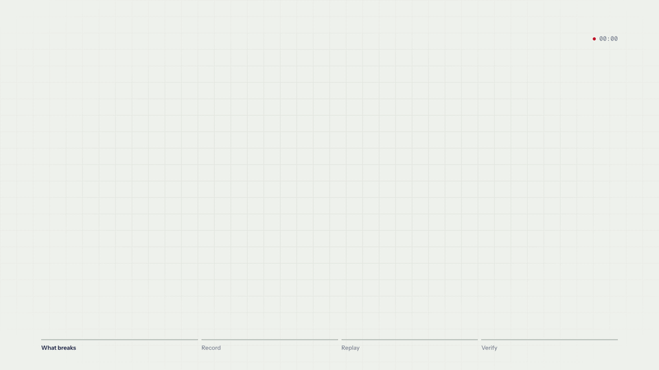

<p align="center">
  <picture>
    <source media="(prefers-color-scheme: dark)" srcset="assets/kavach-banner-dark.png">
    
  </picture>
</p>

[](https://github.com/kavachlabs/kavach/actions/workflows/ci.yml)
[](https://github.com/kavachlabs/kavach/actions/workflows/sdk.yml)
[](https://github.com/kavachlabs/kavach/releases)
[](https://codecov.io/gh/kavachlabs/kavach)

# Kavach — Deterministic PR Verification for Stateful Backends

AI coding agents ship backend PRs faster than unit tests can verify them. Kavach wraps your existing Postgres, Redis, Kafka, and HTTP clients in **Go** (`kavach-go`) and **TypeScript / Node 22** (`@kavachlabs/*`) to record PII-scrubbed production traces and deterministically replay every PR across mutated retry and failure schedules—with **zero business-logic rewrites** and **zero live DBs in CI**.

### 1. Install & equip your coding agent

```bash
# Install Kavach CLI
brew install kavachlabs/tap/kavach        # or: curl -fsSL https://www.thekavachlabs.com/install.sh | sh

# Install Go or TypeScript/Node 22 driver SDK
go get github.com/kavachlabs/kavach-go@v0.3.0                                            # Go (+ adapters/{kavachpgx,kavachredis,kavachkgo}@v0.3.0)
npm install @kavachlabs/core @kavachlabs/http @kavachlabs/pg @kavachlabs/ioredis @kavachlabs/kafkajs  # TypeScript

# Equip Claude Code / Cursor / Codex / Antigravity + scaffold .kavach/ & CI workflow
npx skills@latest add kavachlabs/kavach --skill kavach-setup --skill kavach-invariants
kavach init
```

### 2. Wrap your clients (6 lines, zero handler rewrites)

**Go (`sdk/kavach-go`)**

```go
kv := kavach.Init(kavach.Config{
	Service:  "events-processor",
	RingPath: "/dev/shm/kavach/events.shm", // no-op if unset; replay mode if KAVACH_HOST=1
	PII:      kavach.ScrubStandard,
})
defer kv.Close()

pool  := kavachpgx.Wrap(kv, rawPgxPool)
rdb   := kavachredis.Wrap(kv, rawRedisClient)
kafka := kavachkgo.Wrap(kv, rawKafkaClient)
mux   := kavachhttp.Wrap(kv, appRouter(pool, rdb, kafka))

kv.ServeOrReplay(mux)
```

**TypeScript / Node 22 (`sdk/kavach-ts`)**

```ts
import { init } from "@kavachlabs/core";
import { wrapHandler } from "@kavachlabs/http";
import { wrapPool } from "@kavachlabs/pg";
import { wrapRedis } from "@kavachlabs/ioredis";
import { wrapKafka } from "@kavachlabs/kafkajs";

const kv = init({ service: "events-processor", pii: "standard" });
const pool = wrapPool(kv, rawPool);
const redis = wrapRedis(kv, rawRedis);
const kafka = wrapKafka(kv, rawKafka);
const app = wrapHandler(kv, expressApp);

await kv.serveOrReplay(app);
```

### 3. Gate every PR

```bash
kavach dev --cmd "go run ./cmd/events-processor" --out .kavach/capsules/   # or: --cmd "node dist/main.js"
kavach map --open                                                          # inspect state & sink topology
kavach diff .kavach/capsules/*.kavach --old ./bin/main --new ./bin/pr --variants 25  # prove fix across 25 failure schedules
```

*Need continuous 7-day production capture, automatic PII scrubbing, Immunity Vault invariant mining, or live per-entity quarantine? See [Kavach Enterprise](https://github.com/kavachlabs/kavach-enterprise).*

---

## Measured performance

| Metric | Measured | How |
| --- | --- | --- |
| Recorder overhead per event (shared-memory ring) | **81.2 ns** | Median of 5 runs ([BENCHMARKS.md](BENCHMARKS.md)) |
| Full incident replay, in-process | **61.1 µs** | 33 records, 8 steps, 2 invariants/step |
| Fix verification across 56 variants, in-process | **5.9 ms** | `kavach diff` (`196.4 ms` end-to-end across 105 binary runs) |
| Narrow single-event fixes rejected | **10 / 10** | Ten planted bugs in [`bench/`](bench), `1,000 / 1,000` byte-identical replays |

Explore multi-arm coding agent runs on real open-source incidents at [benchmark.kavachlabs.dev](https://benchmark.kavachlabs.dev).

## CLI quick reference

| Command | What it does |
| --- | --- |
| `kavach init` | Detects Go/TS/Rust drivers, scaffolds `.kavach/{config,invariants}.yaml`, Day-0 `.kavach/map.{json,html}`, and `.github/workflows/kavach.yml` |
| `kavach doctor` | Static Go & TypeScript/JS audit (<2s): driver init sites, bare clock (`time.Now`/`Date.now`), rand/UUID, detached contexts, and tailored wrap snippet |
| `kavach dev --cmd "..."` | Runs your Go or Node service locally over a temp `KVRING02` ring and writes `.kavach` capsules to `.kavach/capsules/` with no external daemon |
| `kavach map [--auto] [--open]` | Generates & opens a standalone interactive HTML flow canvas (`--watch DIR` serves live updates over SSE) |
| `kavach replay <fixture> --bin <cmd>` | Deterministically replays a `.kavach` capsule offline (supports `--invariants`, `--until`, `--probe`, `--hold`) |
| `kavach diff <fixture>... --old <cmd> --new <cmd>` | Proves a fix across mutated retry, gateway fault-injection, clock-shift, and regression variants |
| `kavach skills` / `kavach install-mcp` | 1-command Agent Skills & MCP server setup for Claude Code, Cursor, Codex, and Antigravity |

## Install CLI

Install prebuilt `kavach` and `kavach-recorder` binaries via Homebrew or our zero-dependency shell installer (Linux/macOS `amd64` / `arm64`, also installs all five Kavach agent skills):

```bash
brew install kavachlabs/tap/kavach
# or:
curl -fsSL https://www.thekavachlabs.com/install.sh | sh
```

Or build from source with Go 1.23+:

```bash
go install github.com/kavachlabs/kavach/cmd/kavach@latest
go install github.com/kavachlabs/kavach/cmd/kavach-recorder@latest
```

## Try the ledger demo

<p align="center">
  <picture>
    <source media="(prefers-color-scheme: dark)" srcset="assets/kavach-demo-dark.gif">
    
  </picture>
  <br>
  <sub>
    1080p 60fps video:
    <a href="assets/kavach-hero-dark.mp4">Hero cut (dark, 0:24)</a> ·
    <a href="assets/kavach-hero-light.mp4">Hero cut (light, 0:24)</a> ·
    <a href="assets/kavach-motion-dark.mp4">Full walkthrough (dark, 0:47)</a> ·
    <a href="assets/kavach-motion-light.mp4">Full walkthrough (light, 0:47)</a>
  </sub>
</p>

The demo is a wallet ledger that crashes when upstream sends `"amount": null`:

```bash
git clone https://github.com/kavachlabs/kavach && cd kavach
go install ./cmd/kavach ./cmd/kavach-recorder
go build -o ledger-old ./examples/ledger/sdk
go build -tags ledgerfix -o ledger-new ./examples/ledger/sdk
go build -tags ledgerpartialfix -o ledger-partial ./examples/ledger/sdk

./ledger-old -in examples/ledger/testdata/events.jsonl
kavach inspect kavach/fixtures/ledger-*.kavach
kavach replay  kavach/fixtures/ledger-*.kavach --bin ./ledger-old
kavach diff    kavach/fixtures/ledger-*.kavach --old ./ledger-old --new ./ledger-new      # fixed
kavach diff    kavach/fixtures/ledger-*.kavach --old ./ledger-old --new ./ledger-partial  # variant_failed
```

## See the flow: `kavach map`

Render an interactive, self-contained HTML map showing how events flow from entrypoints through handlers, gateways, sinks, and invariant checks—with recorded/replayed step highlighting and diff verification:

```bash
kavach map --auto --open                               # Day-0 map from static Go/TS scan + .kavach/invariants.yaml
kavach map examples/ledger/.kavach/plan/map.json examples/ledger/testdata/null-amount.kavach \
  --bin ./ledger-old --new ./ledger-new -o ledger-map.html
```

See [MAP.md](MAP.md) for the `map.json` schema, live `--watch` mode, replay/invariant semantics, and stage overlay format.

## With an AI agent

`kavach mcp` is a [Model Context Protocol](https://modelcontextprotocol.io) server with seven tools (`kavach_list_incidents`, `kavach_replay`, `kavach_time_travel`, `kavach_diff`, `kavach_contract_show`, `kavach_contract_check`, and `kavach_map`):

```bash
kavach install-mcp          # configures .mcp.json (or --target claude | cursor)
kavach skills               # installs all 5 Agent Skills (or: npx skills@latest add kavachlabs/kavach)
```

| Skill | What it teaches your agent |
| --- | --- |
| [`/kavach-fix`](skills/kavach-fix/SKILL.md) | Reproduce a `.kavach` crash fixture and generalize the fix until `kavach diff` returns `fixed` across all incident and regression variants. |
| [`/kavach-implement`](skills/kavach-implement/SKILL.md) | Build a new feature contract-first: record baseline traffic, declare spec invariants, stop for human `kavach contract approve`, and iterate until `pass`. |
| [`/kavach-setup`](skills/kavach-setup/SKILL.md) | Map state boundaries into [`.kavach/plan/state-map.md`](examples/ledger/.kavach/plan/state-map.md), then wrap drivers or build a `kavach-host` harness. |
| [`/kavach-verify`](skills/kavach-verify/SKILL.md) | Check another agent's fix or feature and post the verdict without touching code. |
| [`/kavach-invariants`](skills/kavach-invariants/SKILL.md) | Declare invariants in `.kavach/invariants.yaml` or code and mutation-test each one with `kavach replay` and `kavach diff`. |

See [AGENTS.md](AGENTS.md) for the complete verdict loop and rules.

## SDKs

| Language | SDK |
| --- | --- |
| Go (v0.2 driver adapters) | [sdk/kavach-go](sdk/kavach-go) |
| TypeScript / Node 22 (v0.2 driver adapters) | [sdk/kavach-ts](sdk/kavach-ts) |
| Go (direct `env` SDK) | [sdk/go](sdk/go) |
| Python | [sdk/python](sdk/python) |
| TypeScript / JavaScript (direct `env` SDK) | [sdk/typescript](sdk/typescript) |
| Rust | [sdk/rust](sdk/rust) |
| Java | [sdk/java](sdk/java) |
| C and C++ | [sdk/c](sdk/c) |
| Julia | [sdk/julia](sdk/julia) |
| Ruby | [sdk/ruby](sdk/ruby) |
| PHP | [sdk/php](sdk/php) |
| Elixir | [sdk/elixir](sdk/elixir) |
| Haskell | [sdk/haskell](sdk/haskell) |
| OCaml | [sdk/ocaml](sdk/ocaml) |

No SDK for your language? Speak the host & recorder wire protocols directly via [INTEGRATING.md](INTEGRATING.md) and [SPEC.md](SPEC.md) §9–§10.

## In CI (GitHub Actions)

`kavach init` generates a ready-to-commit `.github/workflows/kavach.yml` (Go or Node 22), or use the composite action directly:

```yaml
- uses: kavachlabs/kavach@v0.3.0
  with:
    fixtures: .kavach/capsules/*.kavach
    old: ./bin/service-base
    new: ./bin/service-pr
    variants: 25
```

## Repository guide

| File | What it is |
| --- | --- |
| [sdk/kavach-go](sdk/kavach-go) | v0.2 zero-`memrepo` Go SDK + driver adapters (`kavachhttp`, `kavachpgx`, `kavachredis`, `kavachkgo`) |
| [sdk/kavach-ts](sdk/kavach-ts) | v0.2 zero-`memrepo` TypeScript / Node 22 SDK + driver adapters (`@kavachlabs/{core,http,pg,ioredis,kafkajs}`) |
| [SPEC.md](SPEC.md) | Journal and fixture format, and the host and recorder protocols |
| [MAP.md](MAP.md) | `kavach map` CLI usage, `map.json` spec, invariant rules, and overlay schema |
| [AGENTS.md](AGENTS.md) | How an AI coding agent should use Kavach |
| [INTEGRATING.md](INTEGRATING.md) | Using Kavach from a language with no SDK |
| [action.yml](action.yml) | Composite GitHub Action for `kavach replay` and `kavach diff` in CI |
| [scripts/install.sh](scripts/install.sh) | Zero-dependency installer for Linux and macOS (`amd64` / `arm64`) |
| [BENCHMARKS.md](BENCHMARKS.md) | Every measured number, with its command |
| [examples/ledger](examples/ledger) | The demo wallet ledger service |
| [bench](bench) | Ten planted bugs, each with a correct and a too-narrow fix |
| [CONTRIBUTING.md](CONTRIBUTING.md) | How to contribute (DCO sign-off required) |

## Open source

Kavach is licensed under [Apache 2.0](LICENSE). The core replayer, flight recorder, CLI, Go & TypeScript SDKs, and MCP server are Apache 2.0 and will stay that way. Contributions are accepted under the [Developer Certificate of Origin](DCO).
